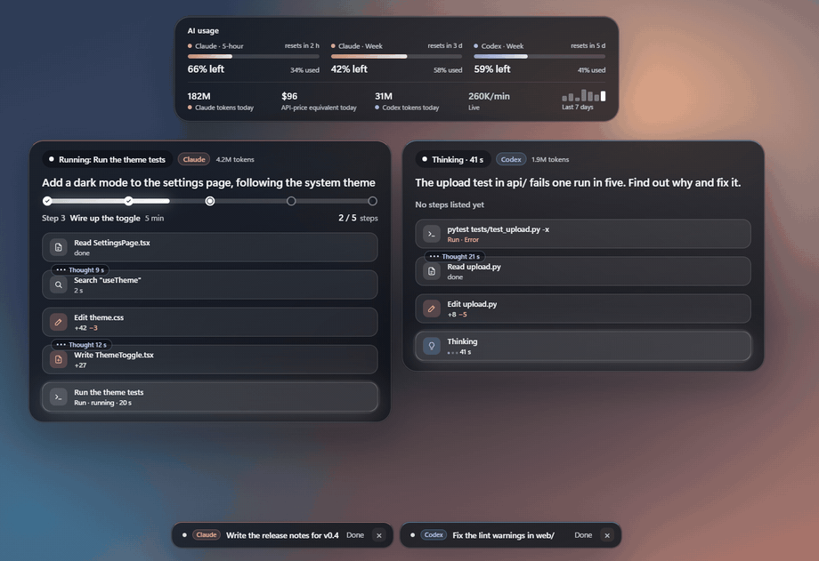
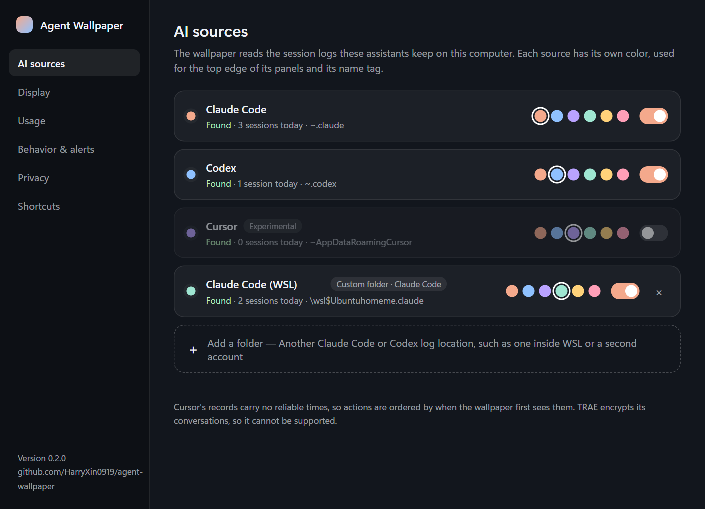

# Agent Wallpaper

**A live desktop wallpaper for Windows and macOS that shows what Claude Code, Codex, Gemini CLI, DeepSeek Harness and Cursor are doing.**

[](https://github.com/HarryXin0919/agent-wallpaper/actions/workflows/ci.yml) [](https://github.com/HarryXin0919/agent-wallpaper/releases/latest) · [中文说明](README.zh-CN.md)



Agent Wallpaper sits behind your desktop icons and draws each running task as frosted-glass panels: the request, the task's step-by-step plan as a progress bar, and the latest actions it took (files read, edits with lines added and removed, commands run, time spent thinking). Above them, a usage panel shows how much of your Claude and Codex plan quota is left.

It reads the session logs these assistants already keep on your computer and never changes them. It changes nothing else on your system unless you turn on an option that says what it changes (see [Privacy and system changes](#privacy-and-system-changes)), and it sends nothing about you over the network (it only asks GitHub whether a new version is out).

## Features

- **Claude Code, Codex, Gemini CLI, DeepSeek Harness and Cursor side by side.** Each source has its own color (Claude coral, Codex blue by default). When several tasks run at once, each gets its own lane. Extra log folders (a second account, Claude Code inside WSL) can be added.
- **Progress you can read at a glance.** Every task gets a continuous progress bar with a percentage. When the agent keeps a plan (Claude's task list, Codex's plan, Gemini and DeepSeek todos), finished steps count in full and the current step is credited by how long it has run and how many actions it has had, compared with the steps already done. When there is no plan, the stage is inferred from the actions (looking around, changing files, running checks) and marked as inferred. Several tasks at once keep the order in which they began.
- **Every action as a card.** Reads, searches, edits (+/− lines), commands, subagents, web lookups and thinking time, newest last; the running one glows.
- **States:** thinking, running a command, waiting for your approval, maybe stuck, done. Approval waits can be reported exactly by an optional Claude Code hook (below).
- **Usage panel:** Claude's 5-hour and weekly quota, Codex's quota, tokens used today and a live tokens-per-minute figure.
- **Click a card** to open that session in the Claude or Codex desktop app.
- **Stays out of the way.** Panels go only into the largest empty part of the desktop. It works over Wallpaper Engine and other live wallpapers, and on Windows it pauses when a full-screen window covers the desktop.
- **Follows the Claude app.** It can appear when the Claude desktop app opens and go away when it closes.
- **Notifications** when a task finishes, when one waits for your approval, and when a quota passes your limit.
- **Privacy mode** for screen sharing: only session titles and kinds of action, no request text, file names or commands.
- **English or Chinese,** one screen or all of them, and adjustable size, position, glass and animation.

## Download

Get the latest build from [Releases](https://github.com/HarryXin0919/agent-wallpaper/releases/latest):

| System | File |
|---|---|
| Windows 10 / 11 | `Agent-Wallpaper-Setup-<version>.exe` (installs for your user) or `Agent-Wallpaper-<version>-portable.exe` (no install) |
| macOS, Apple silicon | `Agent-Wallpaper-<version>-mac-arm64.dmg` |
| macOS, Intel | `Agent-Wallpaper-<version>-mac-x64.dmg` |

The builds are not code-signed yet, so the first start shows a warning:

- **Windows:** SmartScreen says "Windows protected your PC". Click **More info**, then **Run anyway**.
- **macOS:** after the first attempt to open it, go to **System Settings → Privacy & Security** and click **Open Anyway**. (Or run `xattr -dr com.apple.quarantine "/Applications/Agent Wallpaper.app"` once.)

After it starts, the wallpaper appears and a tray icon (menu-bar icon on macOS) gives you its menu.

**Updates.** Every 6 hours the program checks GitHub Releases for a new version. The installed Windows build downloads it in the background and installs it when you quit (or at once with **Restart to update** in the tray menu). The portable build and the macOS build tell you a new version is out and open the download page. Turn this off in Settings → Behavior & alerts.

## Run from source

```powershell
git clone https://github.com/HarryXin0919/agent-wallpaper.git
cd agent-wallpaper
npm install
npm start
```

Needs Node.js 22.13 or later. `npm test` runs the tests; `npm run dist:win` / `npm run dist:mac` build the installers into `dist/`.

## Settings

Right-click the tray icon and choose **Settings…** (or press Ctrl + Alt + Shift + S). Every change is saved and applied at once.



| Page | What you can change |
|---|---|
| AI sources | Turn Claude Code, Codex, Gemini CLI, DeepSeek Harness and Cursor on or off, pick each one's color, add more log folders (a step-by-step guide is built in) |
| Display | Language, position (auto avoids icons, or left / center / right), size, which screens, font (any installed font, or import a .ttf / .otf / .woff / .woff2 file), tasks shown at once, glass depth, animation |
| Usage | Show or hide the usage panel and each quota |
| Behavior & alerts | Appear with the Claude app and go away when it quits, exact approval waits, how long finished tasks stay, notifications and the quota alert level |
| Privacy | Privacy mode |
| Shortcuts | Every shortcut, recorded by pressing the new keys |

**Appear when Claude opens:** the installed program (and the macOS version) adds itself as a login item, waits in the tray, and shows the wallpaper while the Claude desktop app is open. Run from source on Windows, it adds a Startup shortcut to `app/watch.ps1` instead.

## Controls

The tray icon: left-click shows or hides the wallpaper; right-click opens the menu.

| Action | Shortcut |
|---|---|
| Show / hide | Ctrl + Alt + Shift + W |
| Settings | Ctrl + Alt + Shift + S |
| Pause / resume | Ctrl + Alt + Shift + P |
| Hide text (for screen sharing) | Ctrl + Alt + Shift + H |
| Quit | Ctrl + Alt + Shift + Q |

On macOS, Ctrl is the Control key and Alt is Option.

Finished and waiting tasks have a × to clear them; the tray menu can clear all finished tasks or bring them back. A cleared task reappears when it does something new.

If the panels do not appear on Windows, the tray menu has **Can't see it? Try another placement**. Windows versions build the desktop differently, and the choice is remembered.

## Where the data comes from

| Shown | Source |
|---|---|
| Claude tasks | `~/.claude/projects/**/*.jsonl` |
| Codex tasks and Codex quota | `~/.codex/sessions/**/rollout-*.jsonl` (Codex records its quota with every reply) |
| Gemini CLI tasks | `~/.gemini/tmp/*/chats/session-*.jsonl` (Gemini CLI marks a step that waits for approval, so that one is exact) |
| DeepSeek Harness tasks | `~/.dsh/sessions/*/session-*/session.v4.jsonl.zstd` (zstd-compressed; DeepSeek Harness records each permission prompt, so approval waits are exact) |
| Cursor tasks (experimental) | Cursor's `User/globalStorage/state.vscdb`, opened read-only. Cursor stores no reliable per-action times, so actions are timed by when the wallpaper first sees them |
| Claude quota | A local usage service if one is running (below); otherwise the Claude desktop app's own record, `plan-usage-history.json` in its app-data folder |
| Tokens per task, live rate | Counted from the logs |

**Claude quota between readings.** The Claude desktop app records your quota only while it polls. Between its readings, Agent Wallpaper adds the tokens used since the last reading, converted with the ratio it learns from the app's past readings against the same logs. Those figures are prefixed with "~". Usage from claude.ai or other computers is not in the local logs, so the estimate can run low.

**Exact Claude quota (optional).** For exact figures, run a local service that answers `GET http://127.0.0.1:8787/usage` with JSON like `{"ok": true, "session_pct": 21, "week_pct": 70, "session_reset_s": 10600, "week_reset_s": 93000, "tok_today": 182000000, "cost_today_usd": 96, "tok_7d": [...]}`. The proxy from [ClaudeOrb](https://github.com/HarryXin0919/ClaudeOrb) serves exactly this, using your Claude Code login. This is the only thing the program reads over the network, and it is a local address.

## How it works

- **Windows placement.** The window is a layered child of the desktop's `Progman` window, placed below the icon view (`SHELLDLL_DefView`), so icons stay on top and clickable. Two fallback placements cover other Windows builds. `app/icons.ps1` reads icon positions through the shell's `IFolderView` (read-only), and `Glass.freeRect` finds the largest rectangle no icon touches.
- **macOS placement.** The window is a desktop-level window (above the wallpaper, below Finder's icons) on every Space. Finder's icon positions cannot be read without asking for permission, so they are estimated (Finder fills columns from the right); the Position setting can move the panels.
- **Clicks.** The wallpaper cannot receive clicks. The program polls the mouse button and cursor, and only counts a click when it lands on a card while the desktop is in front (on macOS: while Finder is the frontmost app). It opens `claude://`, `codex://` or the Cursor app.
- **Approval waits.** Claude Code's logs do not record permission prompts, so by default a normally instant step pending for over 8 s, or a short command pending for over 40 s, counts as waiting for you. Turn on **Exact "waiting for your approval"** to have them reported instead: this adds one Notification hook to `~/.claude/settings.json` that appends each permission prompt to `~/.claude/agent-wallpaper/events.jsonl` (a copy of the settings file is kept first, and turning the switch off removes the hook).
- **Light on resources.** Every animation runs off one 15 fps clock that sets CSS variables, instead of CSS animations at the screen's refresh rate.

## Project layout

| Path | What it does |
|---|---|
| `src/parse.mjs`, `src/live.mjs` | Read Claude Code logs as they grow |
| `src/codex.mjs` | Read Codex logs into the same timeline |
| `src/gemini.mjs` | Read Gemini CLI sessions |
| `src/deepseek.mjs` | Read DeepSeek Harness sessions |
| `src/cursor.mjs` | Read Cursor's agent conversations (read-only SQLite) |
| `src/hooks.mjs` | The optional approval hook |
| `src/fonts.mjs` | Imported fonts |
| `src/estimate.mjs` | Claude quota estimate between readings |
| `src/settings.mjs`, `src/i18n.js` | Settings with defaults; Chinese and English text |
| `src/flow.js`, `src/scene.js` | Group actions by plan step; infer each task's state |
| `src/glass.js`, `src/glass.css` | The panels |
| `app/main.mjs` | Tray, shortcuts, screens, log watching, usage, notifications, clicks |
| `app/settings.html`, `app/settings.js` | The settings window |
| `app/desktop-win.mjs`, `app/desktop-mac.mjs` | Placement on the desktop, mouse, process checks, per system |
| `app/icons.ps1`, `app/watch.ps1`, `app/startup.ps1` | Windows: icon positions; open with Claude when run from source |
| `test/` | Tests on made-up logs, and a launch check that starts the app and captures the screen |
| `tools/demoframe.mjs`, `tools/demogif.mjs` | Render the README image and animation from made-up tasks |

**Not supported:** TRAE encrypts its conversation database, so it cannot be read.

## Privacy and system changes

This program does not transfer any information about you or your work to other networked systems. Everything it shows is read from files on your own computer. It contacts only:

- `github.com`, to check for and download new versions of itself (every 6 hours; can be turned off in the settings). These are ordinary requests for the release files and carry no data from your computer.
- `127.0.0.1:8787`, on your own computer, and only if you run the optional local usage service described above.

It changes your system only through these options, each explained next to its switch in the settings:

| Option | What it changes | Undone by |
|---|---|---|
| Appear when Claude opens (on by default) | Windows: a login item for the installed app, or a shortcut in the Startup folder when run from source. macOS: a login item | Turning the switch off |
| Exact "waiting for your approval" (off by default) | Adds one Notification hook to `~/.claude/settings.json` (a copy is kept as `settings.json.agent-wallpaper.bak`) | Turning the switch off removes the hook |

## Uninstall

1. In the settings, turn off **Exact "waiting for your approval"** if you turned it on, and **Appear when Claude opens**.
2. Quit from the tray menu.
3. **Windows:** Settings → Apps → Installed apps → Agent Wallpaper → Uninstall (the portable build is a single file; delete it). **macOS:** drag Agent Wallpaper from Applications to the Trash.
4. Optional: delete its settings folder, `%APPDATA%\Agent Wallpaper` on Windows or `~/Library/Application Support/Agent Wallpaper` on macOS, and `~/.claude/agent-wallpaper` if the approval hook was used.

## Not affiliated

Agent Wallpaper is an independent project. It is not made by or affiliated with Anthropic, OpenAI, Google, DeepSeek or Anysphere. Claude, Claude Code, Codex, Gemini, DeepSeek and Cursor are trademarks of their owners.

## License

[MIT](LICENSE)
