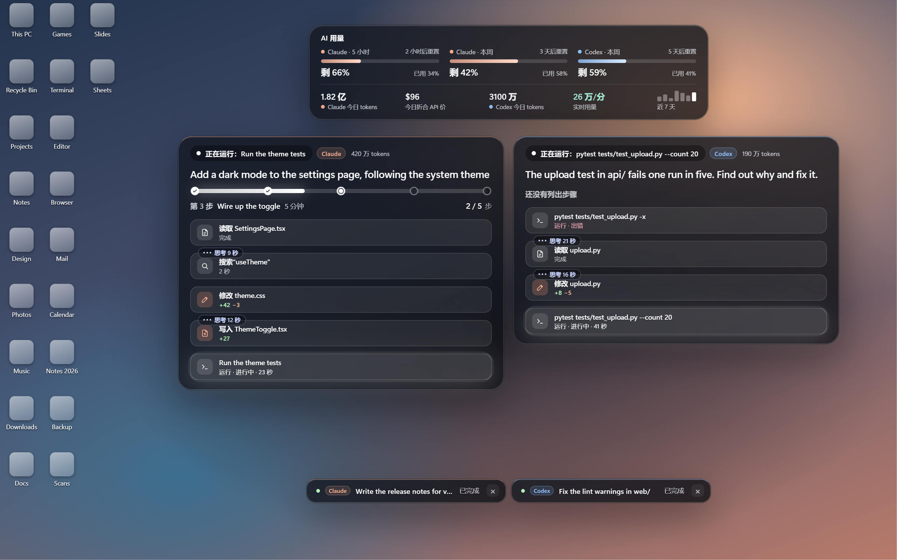

# Agent Wallpaper

**Windows 动态桌面壁纸：实时显示 Claude Code 和 Codex 正在做的事。**

[English](README.md)



壁纸位于桌面图标下面，把每个正在进行的任务画成毛玻璃面板：你提出的要求、任务清单形成的进度条，以及它刚刚做过的操作（读了哪些文件、改了几行、运行了什么命令、思考了多久）。最上面的用量面板显示 Claude 和 Codex 套餐额度还剩多少。

程序只读取 Claude Code 和 Codex 在本机写下的会话记录，不修改记录，不改任何系统设置，壁纸窗口本身也不联网。

## 功能

- **Claude 和 Codex 一起显示：** Claude 的任务用珊瑚色标注，Codex 的用浅蓝色。同时有几个任务在做时，每个任务各占一栏。
- **进度一目了然：** 助手自己列的任务清单（Claude 的任务清单、Codex 的计划）显示成进度条，标出当前第几步、这一步做了多久。
- **每个操作一张卡片：** 读文件、搜索、修改（加了几行、删了几行）、运行命令、子代理、上网、思考时长，最新的在最后，正在进行的那张会发光。
- **状态：** 正在思考、正在运行命令、等你批准、可能卡住了、已完成。
- **用量面板：** Claude 的 5 小时额度和每周额度、Codex 额度、今日 tokens、每分钟实时用量。
- **点卡片跳转：** 在 Claude 或 Codex 桌面端打开对应的会话。
- **不挡图标：** 面板只放在桌面最大的空白区域，每 30 秒重新读取一次图标位置。支持 Wallpaper Engine 等动态壁纸；桌面被全屏窗口挡住时自动暂停。
- **跟随 Claude：** 可以设置成打开 Claude 桌面端时自动出现，退出 Claude 时自动关闭。

## 运行要求

- Windows 10 或 11（程序用 Win32 接口把窗口放到桌面图标下面）
- Node.js 18 或更高版本
- 本机在使用 Claude Code 或 Codex（或两者都用）

## 安装

```powershell
git clone https://github.com/HarryXin0919/agent-wallpaper.git
cd agent-wallpaper
npm install
npm start
```

想让壁纸在打开 Claude 桌面端时自动出现，运行一次：

```powershell
npm run startup:add
```

不想要了就运行 `npm run startup:remove`。

## 操作

单击任务栏右下角的托盘图标可以显示或隐藏壁纸，右键打开菜单。

| 操作 | 快捷键 |
|---|---|
| 显示 / 隐藏 | Ctrl + Alt + Shift + W |
| 暂停 / 继续 | Ctrl + Alt + Shift + P |
| 隐藏文字（投屏时用） | Ctrl + Alt + Shift + H |
| 退出 | Ctrl + Alt + Shift + Q |

已完成或在等你回复的任务，卡片右上角有“×”，点一下即可收起。托盘菜单可以一次清除所有已完成的任务，也可以恢复。收起的任务有了新动作会自动重新出现。

启动后看不到画面时，在托盘菜单里点“看不到画面？换一种显示方式”。不同版本的 Windows 桌面结构不同，程序会记住你选的方式。

## 数据来源

| 显示内容 | 来源 |
|---|---|
| Claude 任务 | `%USERPROFILE%\.claude\projects\**\*.jsonl` |
| Codex 任务和 Codex 额度 | `%USERPROFILE%\.codex\sessions\**\rollout-*.jsonl`（Codex 每次回复都会记下当前额度） |
| Claude 额度 | 本机的用量服务（见下文）；没有时用 Claude 桌面端自己的记录 `%APPDATA%\Claude\plan-usage-history.json` |
| 每个任务的 tokens、实时用量 | 从会话记录里计算 |

**两次实测之间的 Claude 额度：** Claude 桌面端只在轮询时记录额度。在两次记录之间，壁纸以最近一次记录为起点，加上之后用掉的 tokens，按桌面端过去的实测记录推算出的比例换算成百分比，并在数字前标“约”。claude.ai 网页和其他电脑上的用量不在本机记录里，所以估算可能偏低。

**精确的 Claude 额度（可选）：** 在本机运行一个用量服务，让 `GET http://127.0.0.1:8787/usage` 返回类似 `{"ok": true, "session_pct": 21, "week_pct": 70, "session_reset_s": 10600, "week_reset_s": 93000, "tok_today": 182000000, "cost_today_usd": 96, "tok_7d": [...]}` 的 JSON。[ClaudeOrb](https://github.com/HarryXin0919/ClaudeOrb) 里的代理就提供这个接口，用的是你本机 Claude Code 的登录。这是程序唯一通过网络读取的数据，而且只访问本机地址。

## 原理

- **放到图标下面：** 窗口作为桌面 `Progman` 窗口的分层子窗口，插在图标层（`SHELLDLL_DefView`）下面，所以图标始终在上面、照常可点。另有两种备用方式，适配其他版本的 Windows。
- **读取图标位置：** `app/icons.ps1` 通过资源管理器的 `IFolderView` 只读地获取图标位置，`Glass.freeRect` 再找出不碰任何图标的最大矩形。
- **点击：** 壁纸本身收不到点击。程序轮询鼠标左键和光标位置，只有当光标下正好是桌面、并且点在卡片上时才算点击，然后打开 `claude://` 或 `codex://` 链接。
- **“等你批准”是推断的：** 记录里没有权限提示。通常立刻完成的步骤超过 8 秒没有结果，或普通命令超过 40 秒没有结果，就视为在等你批准。
- **省资源：** 所有动画由同一个每秒 15 帧的时钟驱动，不使用按屏幕刷新率运行的 CSS 动画。静止时约占一个 CPU 核心的 2%。

## 文件

| 路径 | 作用 |
|---|---|
| `src/parse.mjs`、`src/live.mjs` | 跟着 Claude Code 记录的增长实时读取 |
| `src/codex.mjs` | 把 Codex 记录整理成同样的时间线 |
| `src/estimate.mjs` | 两次实测之间估算 Claude 额度 |
| `src/flow.js`、`src/scene.js` | 按任务清单的步骤分组；判断任务状态 |
| `src/glass.js`、`src/glass.css` | 毛玻璃面板 |
| `app/main.mjs` | 托盘、快捷键、监听记录、用量、点击 |
| `app/desktop.mjs` | Win32：放到图标下面、鼠标、进程检测 |
| `app/icons.ps1`、`app/watch.ps1`、`app/startup.ps1` | 图标位置；跟随 Claude 打开；开机启动快捷方式 |
| `tools/demoframe.mjs` | 用虚构的任务渲染 `docs/screenshot.png` |

`tools/` 里的预览工具用 Playwright 渲染静态画面（`npm i -D playwright-core`；Chrome 不在默认位置时设置 `CHROME` 环境变量）。

## 声明

Agent Wallpaper 是独立项目，与 Anthropic、OpenAI 没有关联。Claude、Claude Code 和 Codex 是其各自所有者的商标。

## 许可证

[MIT](LICENSE)
