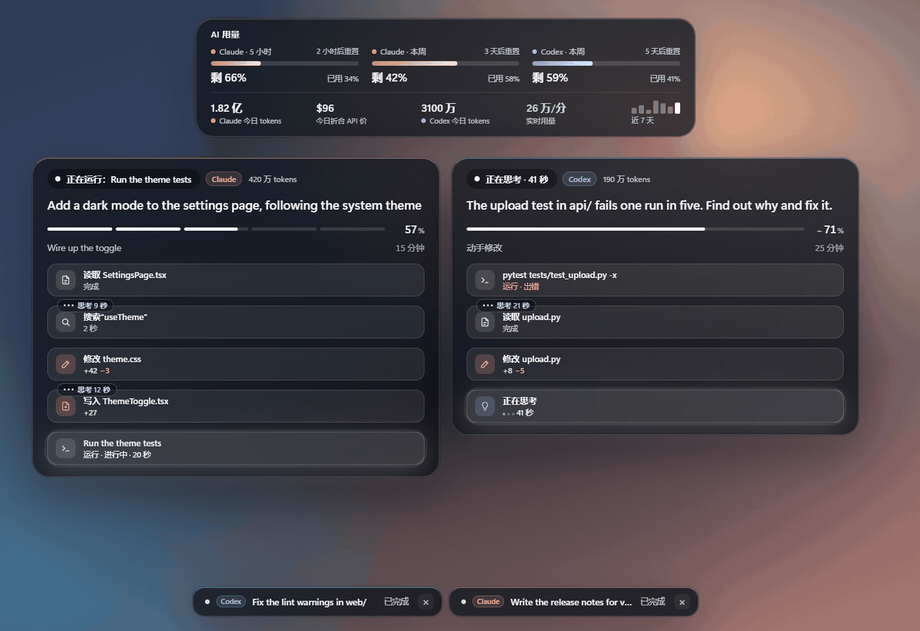
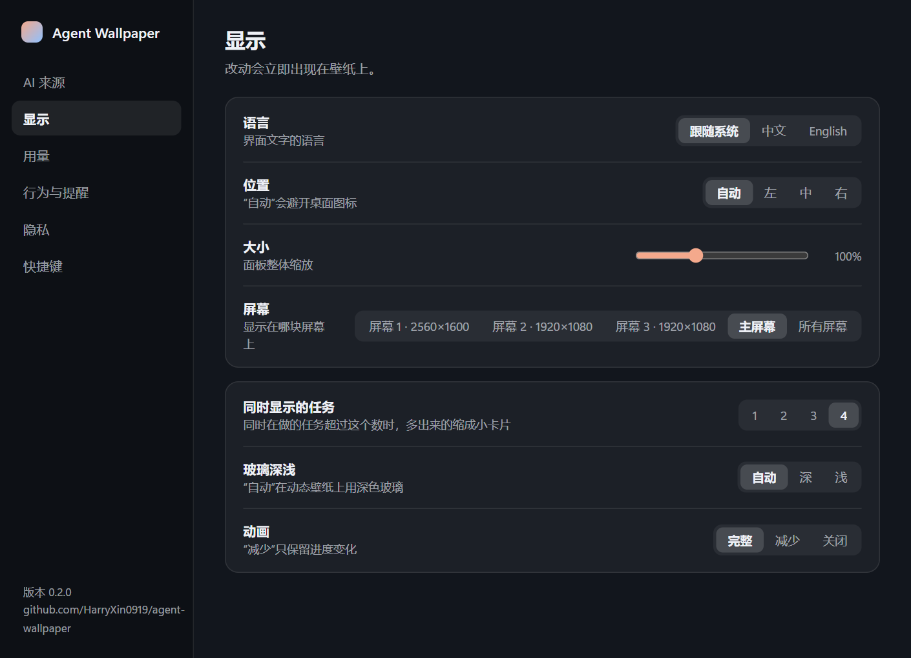

# Agent Wallpaper

**Windows 和 macOS 动态桌面壁纸：实时显示 Claude Code、Codex、Gemini CLI、DeepSeek Harness 和 Cursor 正在做的事。**

[](https://github.com/HarryXin0919/agent-wallpaper/actions/workflows/ci.yml) [](https://github.com/HarryXin0919/agent-wallpaper/releases/latest) · [English](README.md)



壁纸位于桌面图标下面，把每个正在进行的任务画成毛玻璃面板：你提出的要求、任务清单形成的进度条，以及它刚刚做过的操作（读了哪些文件、改了几行、运行了什么命令、思考了多久）。最上面的用量面板显示 Claude 和 Codex 套餐额度还剩多少。

程序只读取这些 AI 在本机写下的会话记录，不修改记录，不改任何系统设置，壁纸窗口本身也不联网。

## 功能

- **Claude Code、Codex、Gemini CLI、DeepSeek Harness 和 Cursor 一起显示：** 每个来源有自己的颜色（默认 Claude 珊瑚色、Codex 浅蓝色）。同时有几个任务在做时，每个任务各占一栏。还可以添加其他记录文件夹，比如第二个账号的，或 WSL 里的 Claude Code。
- **进度一目了然：** 助手自己列的任务清单（Claude 的任务清单、Codex 的计划）显示成进度条，标出当前第几步、这一步做了多久。
- **每个操作一张卡片：** 读文件、搜索、修改（加了几行、删了几行）、运行命令、子代理、上网、思考时长，最新的在最后，正在进行的那张会发光。
- **状态：** 正在思考、正在运行命令、等你批准、可能卡住了、已完成。“等你批准”可以由一个可选的 Claude Code 钩子准确上报（见下文）。
- **用量面板：** Claude 的 5 小时额度和每周额度、Codex 额度、今日 tokens、每分钟实时用量。
- **点卡片跳转：** 在 Claude 或 Codex 桌面端打开对应的会话。
- **不挡图标：** 面板只放在桌面最大的空白区域。支持 Wallpaper Engine 等动态壁纸；在 Windows 上，桌面被全屏窗口挡住时自动暂停。
- **跟随 Claude：** 可以设置成打开 Claude 桌面端时自动出现，退出 Claude 时自动隐藏。
- **通知：** 任务完成、等你批准、额度超过你设的提醒线时弹出系统通知。
- **隐私模式：** 投屏时使用，只显示会话标题和操作类型，不显示提问原文、文件名和命令。
- **中文或英文，** 显示在主屏幕或所有屏幕，大小、位置、玻璃深浅和动画都可以调。

## 下载

在 [Releases](https://github.com/HarryXin0919/agent-wallpaper/releases/latest) 下载最新版本：

| 系统 | 文件 |
|---|---|
| Windows 10 / 11 | `Agent-Wallpaper-Setup-<版本>.exe`（安装到当前用户）或 `Agent-Wallpaper-<版本>-portable.exe`（免安装） |
| macOS，Apple 芯片 | `Agent-Wallpaper-<版本>-mac-arm64.dmg` |
| macOS，Intel 芯片 | `Agent-Wallpaper-<版本>-mac-x64.dmg` |

目前的安装包还没有代码签名，第一次打开时系统会提示：

- **Windows：** SmartScreen 显示“Windows 已保护你的电脑”，点“更多信息”，再点“仍要运行”。
- **macOS：** 第一次尝试打开后，到“系统设置 → 隐私与安全性”里点“仍要打开”。（也可以运行一次 `xattr -dr com.apple.quarantine "/Applications/Agent Wallpaper.app"`。）

启动后壁纸就会出现，菜单在托盘图标里（macOS 在菜单栏）。

## 从源码运行

```powershell
git clone https://github.com/HarryXin0919/agent-wallpaper.git
cd agent-wallpaper
npm install
npm start
```

需要 Node.js 22.13 或更高版本。`npm test` 运行测试；`npm run dist:win` / `npm run dist:mac` 把安装包生成到 `dist/`。

## 设置

右键托盘图标，选“设置…”（或按 Ctrl + Alt + Shift + S）。每项改动都会立即保存并生效。



| 页面 | 可以改什么 |
|---|---|
| AI 来源 | 开关 Claude Code、Codex、Gemini CLI、DeepSeek Harness 和 Cursor，选每个来源的颜色，添加其他记录文件夹（内置分步指南） |
| 显示 | 语言、位置（自动避开图标，或固定在左 / 中 / 右）、大小、显示在哪块屏幕、同时显示几个任务、玻璃深浅、动画 |
| 用量 | 显示或隐藏用量面板，以及其中每一项额度 |
| 行为与提醒 | 跟随 Claude 出现和隐藏、准确识别“等你批准”、完成的任务保留多久、各类通知和额度提醒线 |
| 隐私 | 隐私模式 |
| 快捷键 | 每个快捷键都可以改：点一下，再按下新的组合键 |

**“打开 Claude 时自动出现”：** 安装版（以及 macOS 版）会把自己设为登录时启动，在托盘里等待，Claude 桌面端打开时显示壁纸。在 Windows 上从源码运行时，改为在“启动”文件夹放一个运行 `app/watch.ps1` 的快捷方式。

## 操作

单击托盘图标可以显示或隐藏壁纸，右键打开菜单。

| 操作 | 快捷键 |
|---|---|
| 显示 / 隐藏 | Ctrl + Alt + Shift + W |
| 设置 | Ctrl + Alt + Shift + S |
| 暂停 / 继续 | Ctrl + Alt + Shift + P |
| 隐藏文字（投屏时用） | Ctrl + Alt + Shift + H |
| 退出 | Ctrl + Alt + Shift + Q |

在 macOS 上，Ctrl 是 Control 键，Alt 是 Option 键。

已完成或在等你回复的任务，卡片右上角有“×”，点一下即可收起。托盘菜单可以一次清除所有已完成的任务，也可以恢复。收起的任务有了新动作会自动重新出现。

在 Windows 上启动后看不到画面时，在托盘菜单里点“看不到画面？换一种显示方式”。不同版本的 Windows 桌面结构不同，程序会记住你选的方式。

## 数据来源

| 显示内容 | 来源 |
|---|---|
| Claude 任务 | `~/.claude/projects/**/*.jsonl` |
| Codex 任务和 Codex 额度 | `~/.codex/sessions/**/rollout-*.jsonl`（Codex 每次回复都会记下当前额度） |
| Gemini CLI 任务 | `~/.gemini/tmp/*/chats/session-*.jsonl`（Gemini CLI 会标出等待批准的步骤，所以这一项是准确的） |
| DeepSeek Harness 任务 | `~/.dsh/sessions/*/session-*/session.v4.jsonl.zstd`（zstd 压缩；DeepSeek Harness 会记下每次权限提示，所以“等你批准”是准确的） |
| Cursor 任务（实验） | Cursor 的 `User/globalStorage/state.vscdb`，只读打开。Cursor 的记录里没有可靠的操作时间，所以按壁纸第一次看到的时间排列 |
| Claude 额度 | 本机的用量服务（见下文）；没有时用 Claude 桌面端自己的记录（应用数据文件夹里的 `plan-usage-history.json`） |
| 每个任务的 tokens、实时用量 | 从会话记录里计算 |

**两次实测之间的 Claude 额度：** Claude 桌面端只在轮询时记录额度。在两次记录之间，壁纸以最近一次记录为起点，加上之后用掉的 tokens，按桌面端过去的实测记录推算出的比例换算成百分比，并在数字前标“约”。claude.ai 网页和其他电脑上的用量不在本机记录里，所以估算可能偏低。

**精确的 Claude 额度（可选）：** 在本机运行一个用量服务，让 `GET http://127.0.0.1:8787/usage` 返回类似 `{"ok": true, "session_pct": 21, "week_pct": 70, "session_reset_s": 10600, "week_reset_s": 93000, "tok_today": 182000000, "cost_today_usd": 96, "tok_7d": [...]}` 的 JSON。[ClaudeOrb](https://github.com/HarryXin0919/ClaudeOrb) 里的代理就提供这个接口，用的是你本机 Claude Code 的登录。这是程序唯一通过网络读取的数据，而且只访问本机地址。

## 原理

- **Windows 上的位置：** 窗口作为桌面 `Progman` 窗口的分层子窗口，插在图标层（`SHELLDLL_DefView`）下面，所以图标始终在上面、照常可点。另有两种备用方式，适配其他版本的 Windows。`app/icons.ps1` 通过资源管理器的 `IFolderView` 只读地获取图标位置，`Glass.freeRect` 再找出不碰任何图标的最大矩形。
- **macOS 上的位置：** 窗口是桌面层级的窗口（在壁纸之上、访达图标之下），在每个桌面空间都显示。访达图标的位置不申请权限就读不到，所以按访达从右往左排列的方式估算；也可以在设置里调整面板位置。
- **点击：** 壁纸本身收不到点击。程序轮询鼠标左键和光标位置，只有点在卡片上、并且当时桌面在最前面（macOS 上是访达为当前应用）时才算点击，然后打开 `claude://`、`codex://` 链接或 Cursor。
- **“等你批准”：** Claude Code 的记录里没有权限提示，所以默认按推断：通常立刻完成的步骤超过 8 秒没有结果，或普通命令超过 40 秒没有结果，就视为在等你批准。打开“准确识别‘等你批准’”后改为由 Claude Code 上报：在 `~/.claude/settings.json` 里加一个通知钩子，把每次权限提示追加到 `~/.claude/agent-wallpaper/events.jsonl`（修改前先备份设置文件；关掉开关会删掉这个钩子）。
- **省资源：** 所有动画由同一个每秒 15 帧的时钟驱动，不使用按屏幕刷新率运行的 CSS 动画。

## 文件

| 路径 | 作用 |
|---|---|
| `src/parse.mjs`、`src/live.mjs` | 跟着 Claude Code 记录的增长实时读取 |
| `src/codex.mjs` | 把 Codex 记录整理成同样的时间线 |
| `src/gemini.mjs` | 读取 Gemini CLI 的会话 |
| `src/deepseek.mjs` | 读取 DeepSeek Harness 的会话 |
| `src/cursor.mjs` | 读取 Cursor 的对话（只读 SQLite） |
| `src/hooks.mjs` | 可选的“等你批准”钩子 |
| `src/estimate.mjs` | 两次实测之间估算 Claude 额度 |
| `src/settings.mjs`、`src/i18n.js` | 设置及默认值；中英文文字 |
| `src/flow.js`、`src/scene.js` | 按任务清单的步骤分组；判断任务状态 |
| `src/glass.js`、`src/glass.css` | 毛玻璃面板 |
| `app/main.mjs` | 托盘、快捷键、屏幕、监听记录、用量、通知、点击 |
| `app/settings.html`、`app/settings.js` | 设置窗口 |
| `app/desktop-win.mjs`、`app/desktop-mac.mjs` | 各系统上的桌面位置、鼠标、进程检测 |
| `app/icons.ps1`、`app/watch.ps1`、`app/startup.ps1` | Windows：图标位置；从源码运行时跟随 Claude 打开 |
| `test/` | 用虚构记录做的测试，以及启动程序并截屏的启动检查 |
| `tools/demoframe.mjs`、`tools/demogif.mjs` | 用虚构的任务渲染 README 里的图片和动图 |

**不支持：** TRAE 的对话数据库是加密的，无法读取。

## 声明

Agent Wallpaper 是独立项目，与 Anthropic、OpenAI、Google、DeepSeek、Anysphere 没有关联。Claude、Claude Code、Codex、Gemini、DeepSeek 和 Cursor 是其各自所有者的商标。

## 许可证

[MIT](LICENSE)
